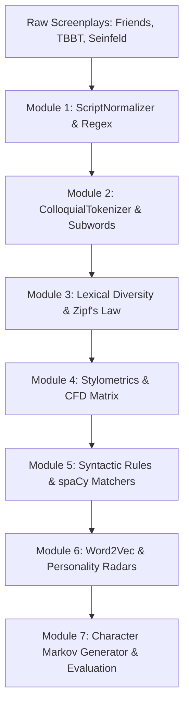

# 📺 Project Writers' Room
### *Deconstructing & Generating Sitcom Dialogue with NLP*

[](https://github.com/evecount/writersroom_NLP_workbook/actions)
[](https://www.python.org/downloads/)
[](https://opensource.org/licenses/MIT)
[](https://github.com/psf/black)
[](https://colab.research.google.com/)

An applied, hands-on pedagogical Natural Language Processing curriculum where students reverse-engineer, analyze, and synthesize comedic television scripts (*Friends*, *The Big Bang Theory*, *Seinfeld*).

Every theoretical NLP topic—from basic regex cleaning and subword tokenization to Zipf's law, dependency parse trees, vector semantics, and character-conditioned Markov language models—directly drives an authentic, recognizable output.

---

## 🏛️ Pedagogical Architecture & Pipeline

```text
Raw Screenplays (.txt / .json)
   │
   ▼
[Module 1: Ingestion & Regex Parsing] ────────► Dialogue Extraction & Speaker Tagging
   │
   ▼
[Module 2: Tokenization & Normalization] ─────► Contractions, Slang & Custom Vocabularies
   │
   ▼
[Module 3: Corpus Statistics & Lexical] ──────► TTR, Hapax Legomena & Zipf's Law
   │
   ▼
[Module 4: Stylometrics & CFDs] ──────────────► Character Voice Fingerprinting & Collocations
   │
   ▼
[Module 5: Syntactic Profiling & spaCy] ──────► POS Tagging, Matchers & Dependency Trees
   │
   ▼
[Module 6: Semantic Clustering & Embeddings] ─► Vector Spaces, Word2Vec & Archetype Math
   │
   ▼
[Module 7: The Script Generator Engine] ──────► Character Markov LM ➔ Neural Synthesis
```



---

## 📚 Curriculum & Notebook Modules

| Module | Title | Core NLP Concepts | Sitcom Application | Colab Link |
|---|---|---|---|---|
| **01** | **Ingestion & Regex Hygiene** | Regular expressions, DRY principles, schema design | Strip stage directions `[...]`, isolate scene headers and parenthetical acting notes `(sarcastically)` | [](https://colab.research.google.com/github/evecount/writersroom_NLP_workbook/blob/main/notebooks/01_script_cleaning_dry.ipynb) |
| **02** | **Colloquial Tokenization** | Word vs subword BPE tokenization, contractions, OOV | Expand conversational speech (*gonna*, *dunno*, *c'mon*); prevent catchphrases (*Bazinga*) from becoming `<UNK>` | [](https://colab.research.google.com/github/evecount/writersroom_NLP_workbook/blob/main/notebooks/02_colloquial_tokenization.ipynb) |
| **03** | **Lexical Diversity & Zipf's Law** | Types vs Tokens ($V, N$), TTR, Root TTR, Hapax Legomena, Zipf's Law | Contrast Sheldon Cooper (dense academic hapaxes) vs Joey Tribbiani (compact conversational vocabulary) | [](https://colab.research.google.com/github/evecount/writersroom_NLP_workbook/blob/main/notebooks/03_lexical_richness_zipf.ipynb) |
| **04** | **Stylometric Fingerprinting** | Conditional Frequency Distributions (CFD), PMI Collocations, Dispersion | Unsupervised detection of multi-word catchphrases (*“we were on a break”*, *“how you doin”*) without hardcoded strings | [](https://colab.research.google.com/github/evecount/writersroom_NLP_workbook/blob/main/notebooks/04_stylometrics_cfd.ipynb) |
| **05** | **Syntactic Structure & Matchers** | POS Tagging, spaCy Matcher, Dependency parse trees | Detect Chandler's rhetorical cadence `[Could] + [PRON] + [BE] + [ADJ]?`; extract Verb $\rightarrow$ Direct Object character habits | [](https://colab.research.google.com/github/evecount/writersroom_NLP_workbook/blob/main/notebooks/05_syntax_spacy_matcher.ipynb) |
| **06** | **Vector Semantics & Tropes** | Distributional Hypothesis, Word2Vec, Cosine Similarity, Vector Arithmetic | Sitcom vector math: $\vec{v}_{\text{Ross}} - \vec{v}_{\text{Paleo}} + \vec{v}_{\text{Physics}} \approx \vec{v}_{\text{Sheldon}}$; build 5-axis personality radar charts | [](https://colab.research.google.com/github/evecount/writersroom_NLP_workbook/blob/main/notebooks/06_sitcom_embeddings.ipynb) |
| **07** | **The Script Generator Engine** | Markov Chains, $N$-gram LMs, Laplace Smoothing, Temperature, LLM benchmarking | Build character-conditioned generator $P(w_t \mid w_{t-1}, \text{Character})$; synthesize crossover scenes; evaluate TTR and consistency | [](https://colab.research.google.com/github/evecount/writersroom_NLP_workbook/blob/main/notebooks/07_script_generator.ipynb) |

---

## ⚡ Quickstart

### 1. Clone the Repository
```bash
git clone https://github.com/evecount/writersroom_NLP_workbook.git
cd writersroom_NLP_workbook
```

### 2. Environment Setup

#### Option A: Using Conda (Recommended)
```bash
conda env create -f environment.yml
conda activate writersroom
```

#### Option B: Using Standard Python Virtual Environment
```bash
python -m venv venv
# Windows:
.\venv\Scripts\activate
# Linux/macOS:
source venv/bin/activate

pip install -r requirements.txt
pip install -e .
```

### 3. Launch Notebooks
```bash
jupyter notebook notebooks/
```

---

## 🧪 Autograding & Local Verification

Students can verify their implementations locally at any point:

```bash
# Run the 7-module automated verification suite
python tests/autograde_checks.py

# Run unit tests
python -m unittest discover tests
```

Sample output:
```text
======================================================================
 PROJECT WRITERS' ROOM: COMPREHENSIVE AUTOGRADING SUITE
======================================================================
[Testing Module 1: Ingestion & Regex Normalization]...       PASS
[Testing Module 2: Tokenization & Slang Handling]...         PASS
[Testing Module 3: Lexical Diversity & Zipf's Law]...        PASS
[Testing Module 4: Stylometrics & Conditional Freqs]...      PASS
[Testing Module 5: Syntactic Structure & Matchers]...        PASS
[Testing Module 6: Sitcom Word Embeddings & Radar]...        PASS
[Testing Module 7: Script Generator Engine & Harness]...     PASS
======================================================================
 [SUCCESS] ALL 7 MODULE VERIFICATION SUITES PASSED PERFECTLY! 
======================================================================
```

---

## 📦 Python Toolkit: `writersroom`

The repository includes a production-ready Python package `writersroom`:

```python
from writersroom import (
    ScriptNormalizer,
    ColloquialTokenizer,
    LexicalAnalyzer,
    StylometricFingerprinter,
    SitcomSyntaxParser,
    SitcomEmbeddingEngine,
    CharacterMarkovEngine,
)

# 1. Clean raw screenplay
normalizer = ScriptNormalizer()
dialogue = normalizer.parse_file("data/raw/friends_sample_raw.txt")
df = normalizer.to_dataframe(dialogue)

# 2. Extract character stylometrics
cfd = StylometricFingerprinter.build_character_cfd(df, ["technically", "bazinga", "could"])

# 3. Detect Chandler's rhetorical cadence
parser = SitcomSyntaxParser()
matches = parser.find_rhetorical_cadences("Could this coffee BE any hotter?")

# 4. Generate dialogue conditioned on Character
generator = CharacterMarkovEngine(n=2)
generator.train_on_dataframe(df)
line = generator.generate_line("CHANDLER", prompt="could this")
print("Chandler:", line)
```

---

## 📂 Repository Structure

```text
writersroom_NLP_workbook/
├── .github/
│   └── workflows/ci.yml               # Automated CI test suite
├── data/
│   ├── raw/                           # Raw scripts (Friends, TBBT, Seinfeld, Multiverse)
│   └── processed/                     # Structured JSON and CSV dialogue corpora
├── notebooks/                         # 7 interactive Jupyter student workbooks
│   ├── 01_script_cleaning_dry.ipynb
│   ├── 02_colloquial_tokenization.ipynb
│   ├── 03_lexical_richness_zipf.ipynb
│   ├── 04_stylometrics_cfd.ipynb
│   ├── 05_syntax_spacy_matcher.ipynb
│   ├── 06_sitcom_embeddings.ipynb
│   └── 07_script_generator.ipynb
├── writersroom/                       # Core modular Python library
│   ├── __init__.py
│   ├── normalizer.py                  # ScriptNormalizer (DRY regex parser)
│   ├── tokenizer.py                   # ColloquialTokenizer (Slang & OOV)
│   ├── metrics.py                     # LexicalAnalyzer (TTR, Hapax, Zipf)
│   ├── stylometrics.py                # StylometricFingerprinter (CFD, PMI)
│   ├── syntax.py                      # SitcomSyntaxParser (spaCy matchers)
│   ├── embeddings.py                  # SitcomEmbeddingEngine (Word2Vec)
│   └── generator.py                   # CharacterMarkovEngine & Evaluator
├── tests/
│   ├── autograde_checks.py            # Local student verification suite
│   └── test_writersroom.py            # Unit tests
├── environment.yml                    # Conda reproducibility manifest
├── requirements.txt                   # Pip dependency requirements
├── pyproject.toml                     # Python package metadata
├── CONTRIBUTING.md                    # Contribution guidelines
├── LICENSE                            # MIT License
└── README.md                          # Master curriculum documentation
```

---

## ⚖️ License & Acknowledgments

This educational project is distributed under the **MIT License**.  
Screenplay dialogues are used under fair use for educational linguistic analysis and pedagogical demonstration.

Created with ❤️ for students mastering Applied Natural Language Processing.
